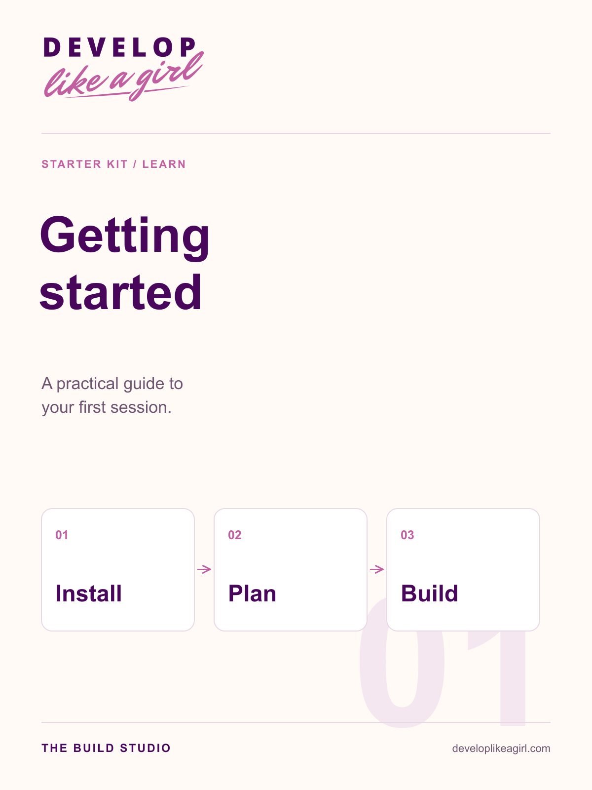
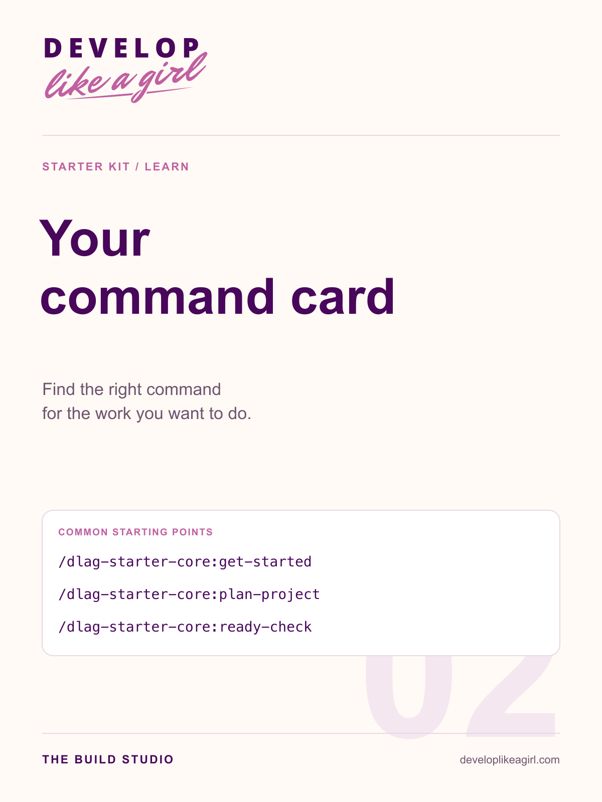
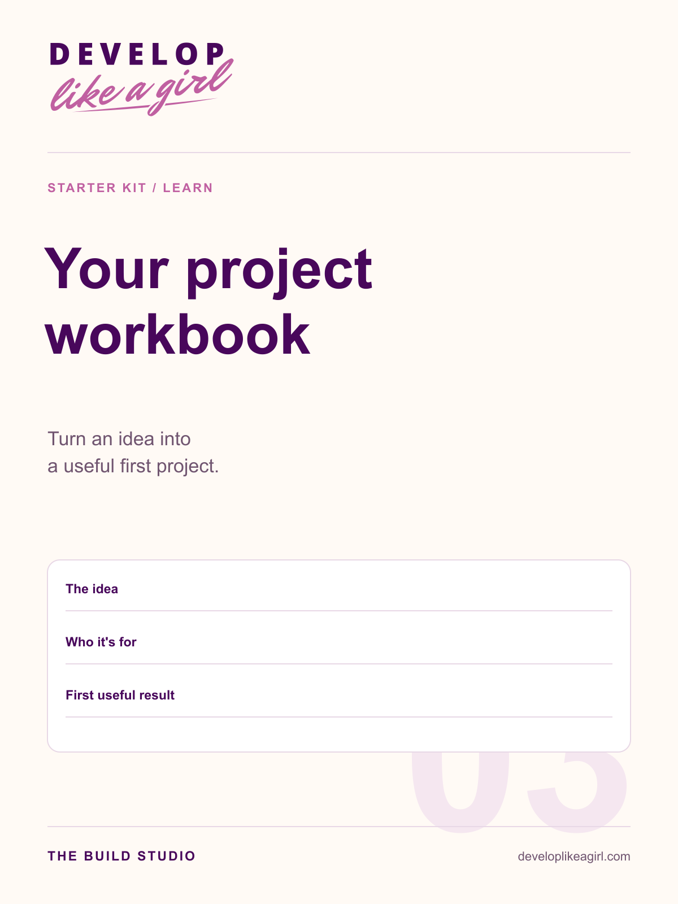

# Starter Kit graphics

A coordinated graphics set for the repository README and learning guides. The banners use the supplied Develop Like a Girl wordmark and Maggie artwork as references. Diagrams and guide covers use the original vector wordmarks and the existing plum, rose and gold palette.

## Ready-to-use files

| Graphic | PNG | Editable SVG | Suggested use |
| --- | --- | --- | --- |
| README banner | [PNG](readme-hero.png) | Raster artwork | Top of the repository README |
| How the studio works | [PNG](studio-workflow.png) | [SVG](studio-workflow.svg) | Start Here and first-session guides |
| Technology map | [PNG](technology-map.png) | [SVG](technology-map.svg) | Stack overview and project setup |
| Getting Started cover | [PNG](covers/getting-started.png) | [SVG](covers/getting-started.svg) | Guide cover |
| Command Card cover | [PNG](covers/command-card.png) | [SVG](covers/command-card.svg) | Command reference cover |
| Project Workbook cover | [PNG](covers/project-workbook.png) | [SVG](covers/project-workbook.svg) | Project brief workbook cover |

Original light and dark wordmarks are bundled in [assets/brand](../brand/). Their SVG and PNG files are unchanged copies of the supplied assets.

## Preview


| Getting Started | Command Card | Project Workbook |
| --- | --- | --- |
|  |  |  |

## Use in the repository README

```markdown

```

Use relative paths appropriate to the containing guide. Keep explanatory prose and actual commands as selectable text alongside graphics. SVG files contain titles and descriptions; use meaningful alt text when embedding either format. The command covers show real namespaced commands but are cover art, not the complete command reference.

The illustrations are conceptual brand artwork. They are not screenshots of a customer application or evidence that an application was built. Installation screenshots should be captured from the actual user flow. Guide contents and PDFs have not been created in this graphics step.
