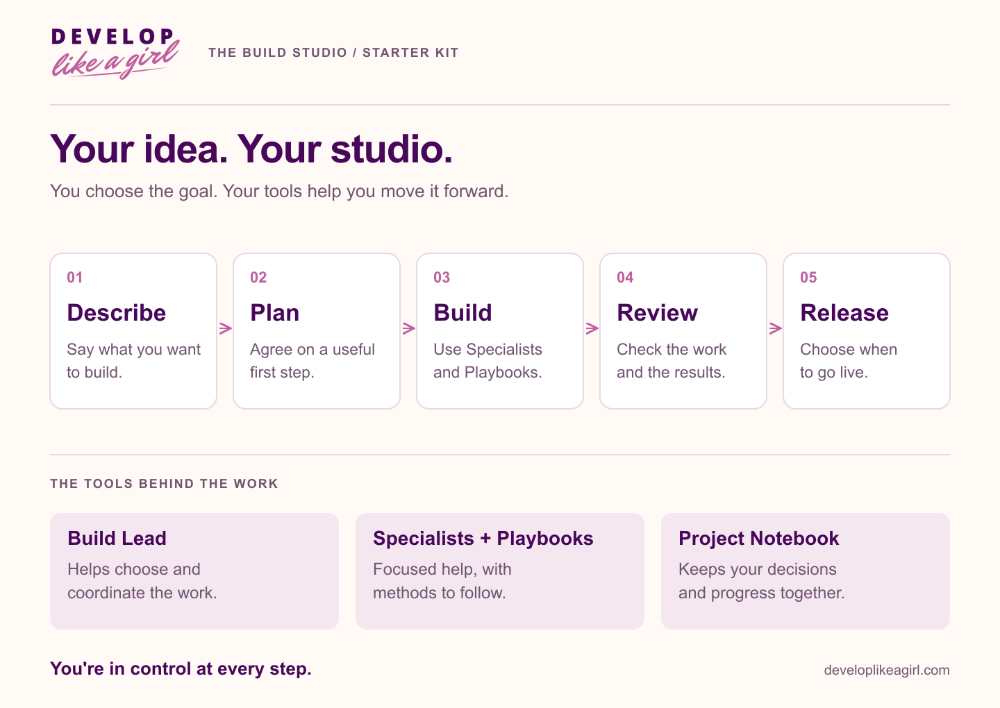

<picture>
  <source media="(prefers-color-scheme: dark)" srcset="../assets/brand/dlag-signature-on-dark-1200.png">
  
</picture>

**THE BUILD STUDIO · STARTER KIT**

# Learn with your Starter Kit

Start with a small result you can see and explain. These guides take you from installation to a focused build and a release decision, using the Playbooks already included in this repository.

## Your first hour

1. [Start here](start-here.md): understand the studio and choose your first outcome.
2. [Install and verify](install-and-verify.md): add Core and the builder you need.
3. [Your first session](your-first-session.md): turn a simple idea into a useful brief.
4. Choose [a website](build-a-website.md), [an app](build-an-app.md), or [an existing project](improve-an-existing-project.md).

## Build with a clear rhythm

| Guide | What you will leave with |
| --- | --- |
| [Work with your Build Lead](work-with-your-build-lead.md) | A bounded task and a clear handoff. |
| [Your Project Notebook](your-project-notebook.md) | A practical place for facts, decisions, and open work. |
| [Review and release](review-and-release.md) | A way to judge completion and prepare an explicit release decision. |
| [Prompts you can use](prompts.md) | Copyable requests for planning, building, explaining, and reviewing. |
| [Troubleshooting](troubleshooting.md) | Checks for missing commands, access problems, and stalled sessions. |

## Keep a guide beside you

| Download | Use it for | Editable companion |
| --- | --- | --- |
| [Getting Started Guide](downloads/getting-started.pdf) | Installation and your first conversation. | [Installation](install-and-verify.md) and [first session](your-first-session.md). |
| [Command Card](downloads/command-card.pdf) | Looking up the 14 public commands. | [Command reference](reference/commands.md). |
| [Project Brief Workbook](downloads/project-workbook.pdf) | Writing down the goal, first task, and review criteria. | [Worksheets](worksheets/README.md). |

## Look something up

[Commands](reference/commands.md) · [Everything included](reference/whats-included.md) · [Technology stack](reference/technology-stack.md)

The repository is the toolkit. Your project folder is where your website or app lives. Work in that folder when using the commands. The guides link to bundled Playbooks when you want their detailed procedures or templates.

---

[Learning hub](README.md) · [Kit overview](../README.md)
