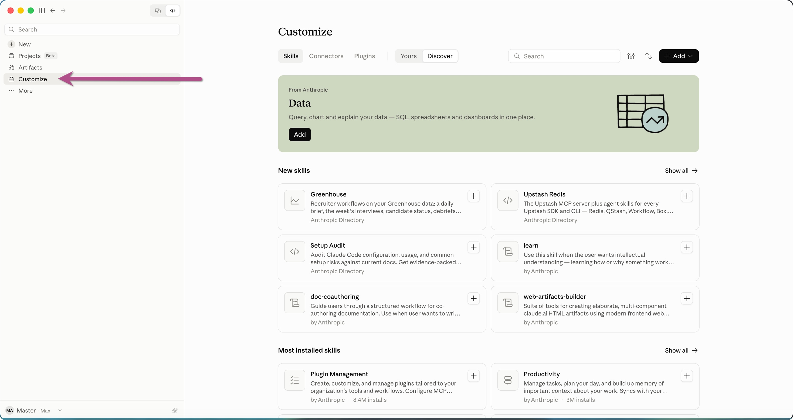
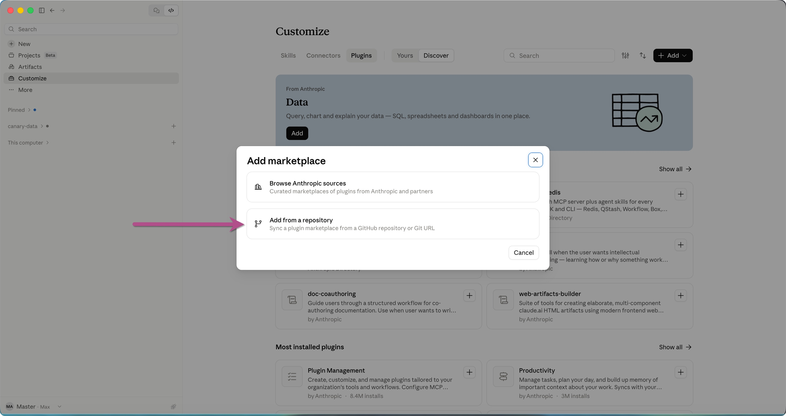
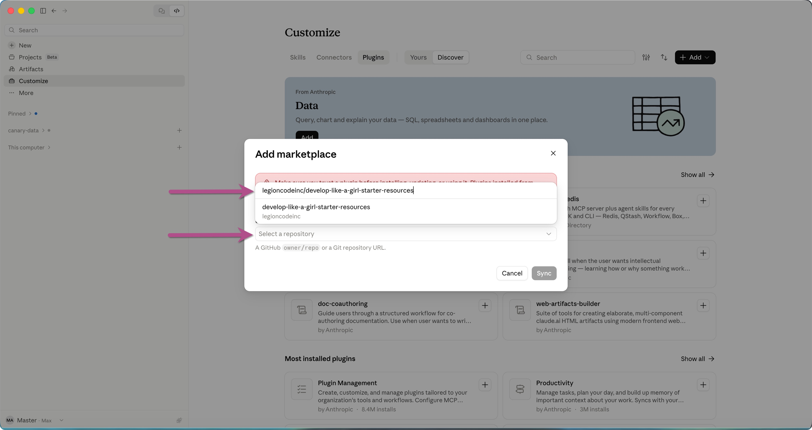
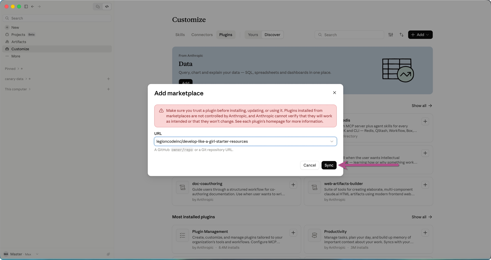
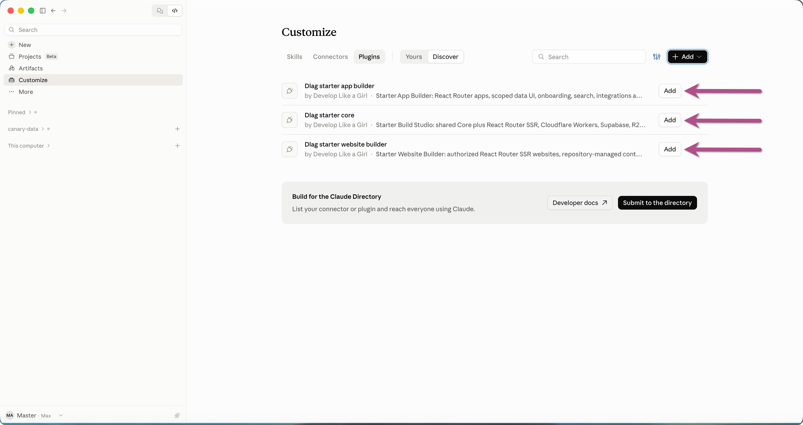

<picture>
  <source media="(prefers-color-scheme: dark)" srcset="../assets/brand/dlag-signature-on-dark-1200.png">
  
</picture>

**THE BUILD STUDIO · STARTER KIT**

# Install and verify your kit

Install through the Claude desktop interface below, or use the [terminal route](#install-from-a-terminal). Then open your own project in Claude Code and check that your kit commands are available.

## Install in Claude desktop

Install and sign in to the [Claude desktop app](https://code.claude.com/docs/en/desktop-quickstart). You do not need a separate CLI installation for this route. The screenshots use **Customize**, which adds plugins to your Claude account. Use the same Claude account when opening Code. See Anthropic's [account plugin and sync instructions](https://support.claude.com/en/articles/13837440-use-plugins-in-claude) for account and organization requirements.

These screenshots show the Starter marketplace in Claude desktop on October 21, 2026. Button placement may vary with your app version.

### 1. Open Customize

In Claude desktop, select **Customize** in the left sidebar.



### 2. Open Plugins and add a marketplace

Select the **Plugins** tab. Open **+ Add** at the upper right, then choose **Add marketplace**.


### 3. Choose Add from a repository

Select **Add from a repository** in the dialog.



### 4. Select this kit's repository

Paste this GitHub repository name into the repository field, then select the matching result:

```text
legioncodeinc/develop-like-a-girl-starter-resources
```

The matching result is `develop-like-a-girl-starter-resources` under `legioncodeinc`.



### 5. Sync the marketplace

Confirm the selected repository, review the notice, and select **Sync**. This makes the marketplace's plugins available to add.



### 6. Add Core, then your builder

Add **Dlag starter core** first. Then add **Dlag starter website builder**, **Dlag starter app builder**, or both. Display capitalization may vary; the exact plugin IDs are listed below.

| Plugin | Exact ID | Use it for |
| --- | --- | --- |
| Core | `dlag-starter-core` | Shared planning, design, implementation foundations, and reviews. |
| Website Builder | `dlag-starter-website-builder` | Public pages, content, and inquiry forms. |
| App Builder | `dlag-starter-app-builder` | Signed-in workflows, data screens, search, and integrations. |



The screenshot shows the plugins available with **Add** buttons. Select Add for each plugin you want, and confirm it appears under **Yours**. Syncing the marketplace alone does not add all three plugins.

## Open your project and verify

Open the **Code** view in Claude desktop, choose a **Local** environment, and select **your own project folder**. Start a new session signed into the same Claude account. In the prompt box, type `/` and look for this kit's commands. For example:

```text
/dlag-starter-core:get-started Inspect this folder and propose a first task.
Keep the proposal in chat.
```

A useful response describes the folder and recommends a next task. This command prepares a setup proposal; application implementation follows separately. The kit commands go in the Code prompt box. Commands beginning with `claude plugin` belong in a terminal.

Account-installed plugins sync into supported Claude Code versions. If a command is missing, check **Customize → Plugins → Yours**, confirm the same account, and start a fresh Code session. Organization policy or disabled sync can affect availability. See the [official sync guidance](https://support.claude.com/en/articles/13837440-use-plugins-in-claude) and [desktop command guidance](https://code.claude.com/docs/en/desktop#use-skills).

You do not need to clone this marketplace or work inside its `plugins/` directory. Your app or website belongs in its own folder.

## Install from a terminal

Use this alternative if you prefer the CLI. You do not need to repeat it after a successful desktop account installation and command check.

Have Claude Code CLI and Git available. Follow the [CLI setup guide](https://code.claude.com/docs/en/setup) if needed, then check:

```bash
claude --version
git --version
```

Add the marketplace and install Core:

```bash
claude plugin marketplace add https://github.com/legioncodeinc/develop-like-a-girl-starter-resources.git
claude plugin install dlag-starter-core@dlag-starter
```

Install the builder you need, or both:

```bash
claude plugin install dlag-starter-website-builder@dlag-starter
claude plugin install dlag-starter-app-builder@dlag-starter
```

These commands install at user scope by default. Local desktop Code sessions on the same computer share those settings. CLI installations remain local to the machine; they do not add plugins to your Claude account. [Installation scopes and account sync](https://code.claude.com/docs/en/discover-plugins).

Open a terminal in your project folder and run `claude`, or open that folder in desktop Code. In the terminal CLI session, `/plugin` shows installed plugins. On desktop, type `/` in the Code prompt to check the available kit commands.

## If installation stops

Check the exact repository name, account access, and any organization restrictions. An **Add** button means the plugin still needs to be added. If it is added but missing from Code, check account sync and session availability before reinstalling. Do not paste credentials into a prompt or issue. [Troubleshooting](troubleshooting.md) has the next checks.

**Next:** [Your first session](your-first-session.md).

---

[Learning hub](README.md) · [Kit overview](../README.md)
