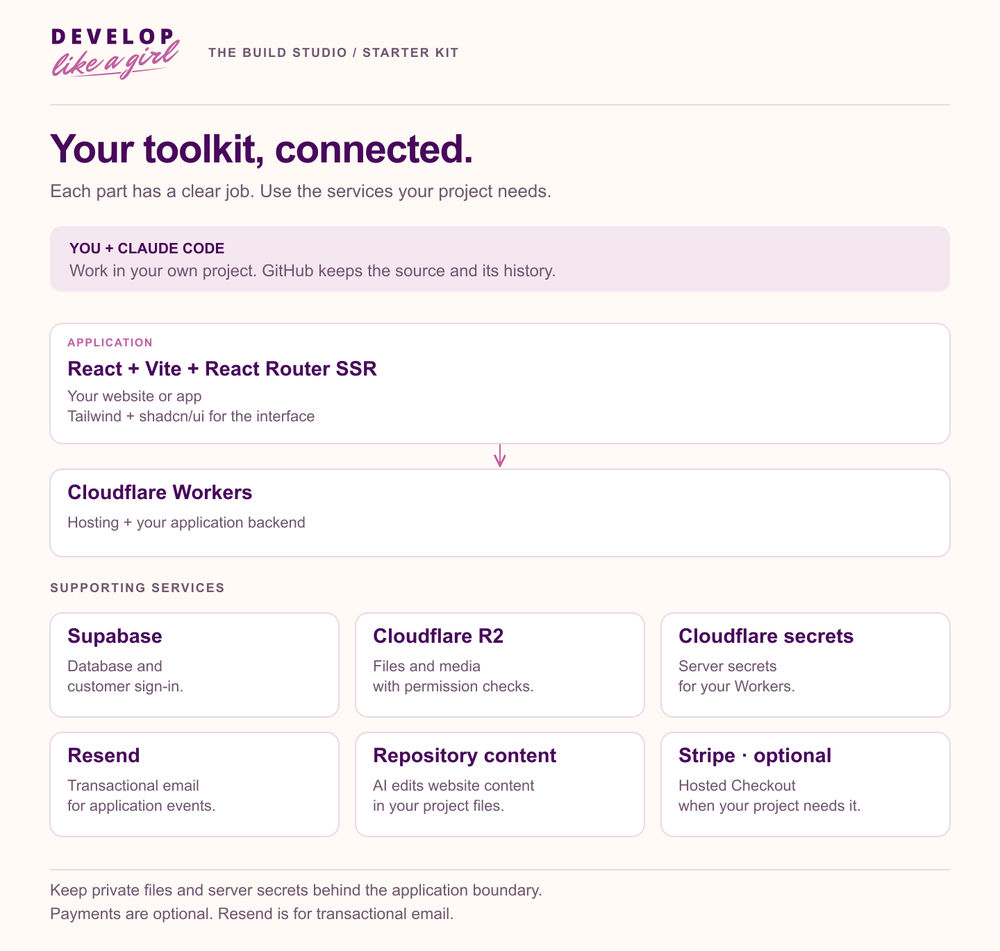

<picture>
  <source media="(prefers-color-scheme: dark)" srcset="../../assets/brand/dlag-signature-on-dark-1200.png">
  
</picture>

**THE BUILD STUDIO · STARTER KIT**

# Technology stack

The Starter Kit assigns each part of the system a clear responsibility. These are the supported implementation patterns; installing the plugin does not create service accounts or configure a running application.

| Area | Technology | Responsibility |
| --- | --- | --- |
| Interface | React, Vite, React Router framework SSR | Server-rendered public and signed-in web experiences. |
| Interface components | Tailwind and shadcn/ui | Project-owned styling, controls, and component foundations. |
| Hosting and server | Cloudflare Workers | App request handling, actions, and server-side integrations. |
| Data and identity | Supabase PostgreSQL and Auth | Application records, authentication, and row ownership policies. |
| Website content | Project-maintained content | Content kept with the website; no separate CMS required. |
| Private files | Cloudflare R2 | Authorized object uploads and downloads. |
| Secrets | Cloudflare Workers secrets | Private values supplied at the server boundary. |
| Transactional email | Resend | Product-triggered messages and delivery handling. |
| Optional payments | Stripe-hosted Checkout | Hosted payment collection and server-verified fulfillment. |

## Boundaries that matter

Private credentials stay on the server. Identity establishes who is making a request; authorization decides which records and actions that person may access. File access and search must respect the same permissions as the underlying application. Payment and message workflows need explicit verification of their provider behavior.

React Router SSR runs at the Worker boundary. Supabase row ownership policies complement server checks; hiding a control in React does not protect the corresponding operation.

## Add services when the feature needs them

A public information page does not require every provider in the map. Start from the accepted feature and identify its actual dependencies. The current email resources cover transactional messages. Newsletter campaigns and a general-purpose background-job system are not bundled features.

For an existing project, compare its stack before implementation and resolve meaningful differences with the owner. These guides do not authorize a stack migration.

**Related:** [Everything included](whats-included.md) · [Build a website](../build-a-website.md) · [Build an app](../build-an-app.md).

---

[Learning hub](../README.md) · [Kit overview](../../README.md)
