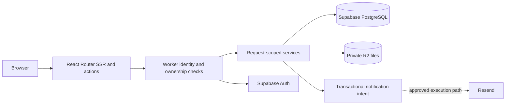

# One request boundary across routes and services

> Category: Architecture | Version: 1.0 | Date: October 2026 | Status: Draft / NOT_RUN

Synthetic architecture-document example. It uses this structure: motivation, diagram, shared core, write/read paths, durable substrate, failure table, related source map and revision history. It does not claim an application exists or runs.

## Why this shape

React Router framework-mode SSR and request actions run on Cloudflare Workers. Routes adapt HTTP requests to explicit services. Services receive the verified identity and owner scope; they do not trust identity fields supplied by a browser. The same boundary is used by website and app routes rather than duplicating authorization in several UI components. Claude Code is the only assistant supported by Starter.

## Architecture

## Shared core

Keep durable application rules in server-only, request-scoped services. An illustrative `app/services/profile.server.ts` is called by the route adapter. Cloudflare runtime bindings supply secrets and R2; browser loader output excludes those bindings. No module-global authenticated client carries identity from another request. The diagram's email edge is conditional because no background runner is selected.

## Write path

The route validates request shape and origin/CSRF for cookie-authenticated mutations, verifies Supabase identity and current record ownership, then calls the service with the derived owner. A database transaction enforces the intended local state transition. R2 bytes require a separate authorization and finalization check. An upload remains quarantined until its object and metadata meet the accepted policy. Notification intent may be recorded with the local change; this does not make remote email atomic.

## Read path

An SSR loader checks identity and owner scope before returning private data. The database may apply RLS, while privileged calls need their own explicit identity/ownership verification. Private downloads authorize the database record and object access separately through the Worker. An untrusted file key, a logged-in browser or an RLS policy does not by itself grant R2 access.

## Durable substrate and migrations

Supabase PostgreSQL stores owner-scoped records and file metadata. R2 stores bytes. Schema additions use reviewed project migrations, constraints, indexes and rollback/recovery planning. There is no automatic schema-healing process and no additional memory/vector provider selected by this example. Cite actual tables, constraints, policies and migration paths after inspection; do not fabricate them from this diagram.

## Failure modes

| Layer | Failure | Evidence to inspect | Required handling |
| --- | --- | --- | --- |
| Route adapter | Invalid shape or origin | Rejected request and absence of mutation | Explicit validation response; no state change |
| Identity | Missing, revoked or cross-owner session | Anonymous/A-versus-B denial | Deny before data or file access |
| Data transition | Transaction failure or retry | Rollback and idempotency evidence | No partial grant; classified retry |
| File boundary | Wrong owner, missing object or expiry | Finalization/download denial | Keep private; do not mark ready prematurely |
| Notification | Provider acceptance or delivery failure | Intent identity and actual delivery status | Separate acceptance from delivery; no selected background processor implied |

## Related code and verification

Illustrative paths: `app/routes/profile.tsx`, `app/services/profile.server.ts`, `app/services/supabase.server.ts` and project migrations. In a real document link each actual source path, symbol and subject revision. Static source review, compilation, browser execution and live provider behavior need separate records.

## Changelog

- Version 1.0: constructed architecture-document adaptation; all implementation and execution remain NOT_RUN.
