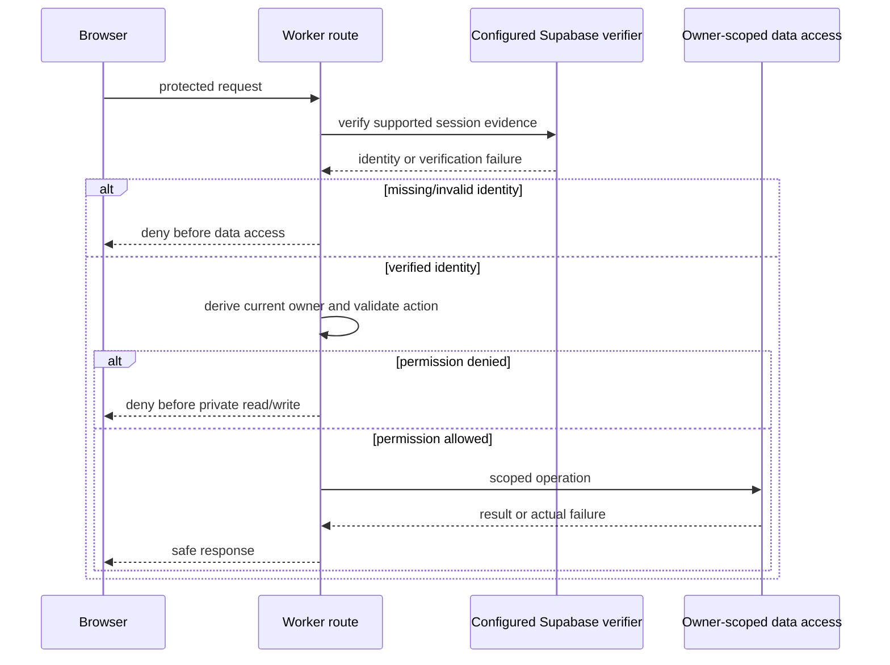

# Example: identity and ownership architecture

Synthetic abbreviated Auth document specimen, NOT_RUN. It preserves the provider-choice explanation, first-class sequence, non-obvious request state and credential/session lifecycle sections without introducing another token issuer or a CLI flow.

> Category: Auth | Version: 1.0 | Date: [actual date] | Status: Draft

How the real application verifies a Supabase session and authorizes a record request at the Worker.

**Related:** actual session lifecycle, ownership policy, callback rules and accepted decision record, after resolving them in the target repository.

## Why identity is separate from permission

Supabase Auth owns authentication. The Worker owns custom application operations and must still check current record ownership. A user ID, selected workspace or decoded browser token does not prove permission. A real document names the supported server verifier and its exact input/output/error contract from inspected code; the diagram below remains intended until that source is supplied.

## Request flow

## Request state, callbacks and retries

Document the actual callback allowlist, state/correlation validation and any replay or refresh handling only when the source implements them. Distinguish stable request/attempt identity from per-attempt provider values. A retry must not silently duplicate a mutation or bypass callback checks. Do not invent a polling key, redirect policy or token lifecycle from a diagram. Unknown mechanisms remain explicit gaps.

## Session and credential lifecycle

Explain where the actual server session evidence is obtained, validated, refreshed and cleared; record expiry, revocation and sign-out behavior from actual implementation/provider evidence. Keep credentials in Cloudflare's server-side secret/runtime boundary, never in browser loaders, source examples or logs. Supabase verification establishes identity while current owner checks and database policies govern records. An R2 file requires its own access check and approved delivery/revocation policy.

## Failure and qualification

Trace anonymous, invalid/expired, cross-owner, revoked and downstream failure paths. Preserve exact call order and error handling; include actual source paths/symbols and subject identity. Source observation, mocked tests, native browser behavior and live provider verification are separate. No login, credential access, provider configuration or application execution occurred for this specimen.

## Why this form helps

The opening explains the provider and boundary choice, the sequence includes terminal denial paths, request-state detail exposes non-obvious replay risks and the lifecycle section makes secret/session handling visible. A real document uses concrete verified defaults and related accepted decisions rather than vague assurances.
