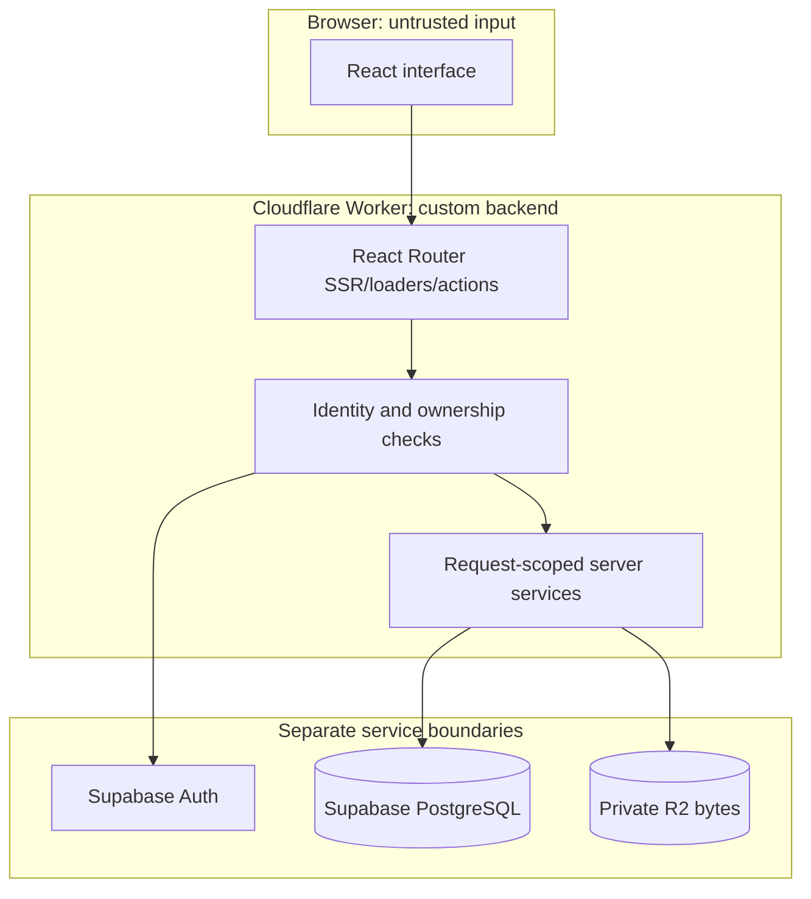

# Example: system overview

Synthetic abbreviated architecture specimen, NOT_RUN. It demonstrates the complete document shape and useful Mermaid grouping; a real overview must replace every intended component with actual source-backed mechanisms and evidence.

> Category: Architecture | Version: 1.0 | Date: [actual date] | Status: Draft

How the browser, React Router Worker, Supabase and private R2 storage relate, including the identity and file-access boundaries.

**Related:** actual request lifecycle, session/ownership policy, complete schema reference and accepted ADR paths after inspection in the target repository.

## Architecture diagram

These boxes show logical groupings, not automatically enforced trust. Inspect the actual validator, server verification, owner-scoped queries and R2 authorization for each arrow. Database RLS cannot authorize an object download. Cloudflare secrets remain server-only; loader output becomes browser-visible.

## Component summary

| Component | What a real document must explain | Required source detail |
| --- | --- | --- |
| Browser and React routes | Entry action, rendered/pending/error states and SSR/hydration | Actual route/component paths and data exposure |
| Worker checks/services | Identity, owner derivation, early denials and failure behavior | Exact verifier and protected-operation call order |
| Supabase | Auth session and PostgreSQL metadata/policies | Actual schema, RLS/grants and privileged-call checks |
| R2 | Private bytes, upload quarantine/finalization and download access | Actual object/metadata binding and revocation policy |
| Optional transactional email | Intended message versus accepted send versus delivery | Only real Resend paths; no runner assumed |

## Key design decisions

For each consequential actual choice, record its accepted ADR and the source behavior it supports: Worker custom backend ownership, Supabase identity versus record permission, R2 byte access separate from database policies, and private/public file separation. Do not fabricate an accepted ADR from this illustrative table. Optional hosted Stripe needs its own actual server entitlement and webhook evidence when selected.

## Failure and evidence boundaries

A complete overview links to denied/invalid requests, stale/revoked identity, cross-owner access, database failures, unfinalized files and external-delivery failures where implemented. A diagram, grouped box or accepted design does not prove any path executed. No queue, background provider, AI daemon, additional assistant or CMS dashboard is implied.

## Why this form helps

The overview gives the reader the architecture first, then concrete component/source responsibilities, then actual decision pointers and limitations. Use readable local links, color-free diagrams, short connected explanations and the full schema/flow references for depth. No inspected code or execution evidence exists for this constructed architecture itself.
