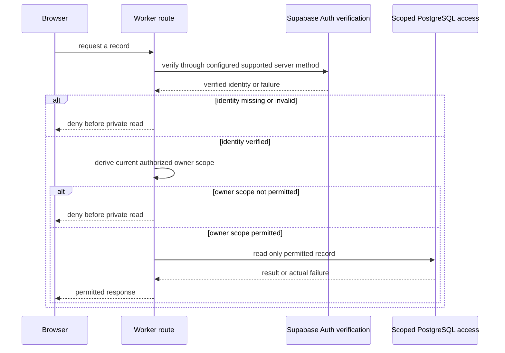

# Document Format Specification

Every knowledge doc must follow this exact format. Consistency across all docs makes the knowledge base feel like a single authored artifact, not a pile of individually-styled pages.

---

## Annotated Template

The following is a synthetic document shape, NOT_RUN. Replace its statements with actual inspected sources; it is not a Supabase integration recipe.

````markdown
# Session and Record Access

> Category: Auth | Version: 1.0 | Date: [actual edit date] | Status: Draft

How this application's Worker verifies identity and checks record ownership before returning private data.

**Related:** [Actual sibling lifecycle document, permission policy and accepted ADR paths.]

## Why the identity and ownership checks are separate

Supabase Auth supplies identity. The application must still authorize the requested record.
Describe the real verifier and query from inspected source. Missing implementation stays unknown.

## Request flow



## Session lifecycle

Name the actual cookie/session handling, expiry, revocation and callback verification.
Never include tokens or credentials. An example diagram cannot establish those mechanisms.

## Known limitations

This intended diagram needs actual code, exact source locators, denial/failure evidence and
renderer qualification before being described as inspected or executed behavior.
````

---

## Header Rules

| Field | Value |
|---|---|
| `Category` | Domain folder name, Title Case (e.g., `Auth`, `AI`, `Data`, `Security`) |
| `Version` | Start at `1.0`; use `1.1` for additions and `2.0` for a substantive restructure when that matches the existing document convention |
| `Date` | Month + year of last meaningful edit (`May 2026`) |
| `Status` | `Active` for live docs; `Draft` for in-progress; `Archived` for superseded |

---

## Related Section Rules

- Link to 3-8 items
- **Order:** sibling docs in the same domain first, then cross-domain docs, then ADRs last
- Use relative paths: ``title` (target-project link to fill: `relative-path.md`)`
- ADR links: ``ADR-NNN title` (target-project link to fill: `../architecture/ADR-NNN-slug.md`)`
- PRD links: ``prd-NNN` (target-project link to fill: `../../../requirements/backlog/prd-NNN-slug/prd-NNN-slug-index.md`)` (use sparingly - knowledge docs reference ADRs, not PRDs)

---

## Section Structure

### H2 for major concepts
One H2 per major concept or component. Each H2 should be independently readable.

### H3 for subsections within a concept
Use H3 when an H2 section has multiple distinct sub-topics. Avoid H4+ - if you need H4, split into a separate doc.

### Progressive disclosure
- H2 section 1: "Why this exists" - the motivation
- H2 sections 2-N: technical details, schemas, flows, code samples
- Last section (optional): "Alternatives considered" or "Known limitations"

---

## Code Block Standards

**SQL DDL:** Include every actual column/type/default/nullability, constraint, index, policy, grant, trigger and function in the inspected scope. Do not use ellipses to hide omitted schema. Cite authoritative PostgreSQL migrations/declarations and distinguish planned from existing state. Do not imply database RLS authorizes R2 objects.

Teaching schema only, NOT_RUN and not a project migration:

```sql
CREATE TABLE teaching_file_records (
  id uuid PRIMARY KEY,
  owner_id uuid NOT NULL,
  object_key text NOT NULL UNIQUE,
  state text NOT NULL CHECK (state IN ('quarantined', 'released')),
  created_at timestamptz NOT NULL DEFAULT now()
);
CREATE INDEX teaching_file_records_owner_idx ON teaching_file_records (owner_id);
```

The specimen intentionally has no actual identity FK/RLS/grants: a real complete reference must include the real policies and constraints, or explicitly record that they are absent. Do not infer private access from this illustrative table.

**TypeScript:** Real code with types. Show actual function signatures, not pseudocode.

```typescript
export interface ColumnDef {
  /** Bare column identifier, e.g. `contributors`. */
  name: string;
  /** Column SQL minus the name, e.g. `TEXT NOT NULL DEFAULT '[]'`. */
  sql: string;
}
```

**Mermaid diagrams:**
- `flowchart TD` for process flows
- `sequenceDiagram` for temporal flows (request/response)
- `stateDiagram-v2` for state machines
- NO explicit colors (breaks dark mode)
- NO `click` events (disabled for security)
- Node IDs: `camelCase` only (no spaces)
- Quote labels with special chars: `A["Process (main)"]`

**Operational commands:** A requested how-to documents only actual existing project commands after inspecting package scripts/configuration, with prerequisites, environment, expected output, failure and rollback boundaries. This narrative-authoring capability does not execute commands or install tools. Do not invent a build script, credential CLI or deployment command from another product.

---

## Prose Style

**Do:**
- Open each section with the most important sentence (inverted pyramid)
- Use direct, active voice
- Name actual inspected functions, query constraints and returned fields rather than vague descriptions such as "the data code"
- Cite specific table/column names, file paths, function names
- Explain trade-offs when they matter ("Why X instead of Y: ...")

**Don't:**
- Use passive voice: "it is ensured that..." -> "the middleware ensures..."
- Use filler phrases: "It should be noted that", "In this case", "As mentioned"
- Repeat the title in the first sentence
- Write bullet soup when prose works better
- Use unsupported certainty. Be direct about observed facts and explicit about genuine uncertainty

---

## Doc Length Guidelines

| Doc type | Target length |
|---|---|
| `overview.md` (top-level) | 100-200 lines |
| Architecture narrative | 150-300 lines |
| Schema doc (full DDL) | 200-500 lines |
| Domain narrative | 100-300 lines |
| Standards doc | 100-200 lines |

## Bounded beginner-tour exception

The domain-document length targets above remain for deep references. A one-journey beginner tour may be shorter when its source supports the complete requested scope. Do not pad missing facts. Use guide 04 and its ledger, preserve actor/permission/order/source-status limits and report missing implementation/runtime evidence.

## Source-grounded diagram qualification

Use [guide 06](06-preserve-behavior-in-diagrams.md) before drawing calls, state or trust boundaries. Keep a hashed source ledger, denied/error paths and intended-versus-implemented distinctions. Shapes, arrow styles and boxes add no permission, delivery or atomicity guarantees. Parsing/display and behavioral/source checks are separate evidence.

Use the Related-link and length ranges as useful targets for real deep references. Never invent peer documents, source paths, acceptance or extra paragraphs to meet a numeric quota. A bounded source-supported tour may be shorter; report unavailable related sources explicitly.
