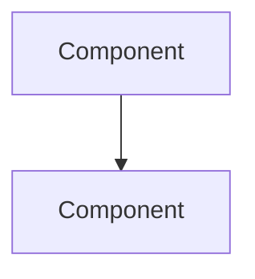

# Write narrative Project Notebook documentation

Explain how the actual system works, why accepted choices matter and what the operational details mean. Use scoped local source evidence before writing. Keep requirements, actual implementation, accepted decisions and execution distinct. A named specialist or function does not prove a method ran or an access policy exists.

## What This Skill Produces

Docs like:
- A Draft decision and action handoff from explicitly supplied local meeting notes or transcripts, with exact sources and unresolved authority, assignee, acceptance and deadline evidence.
- A bounded beginner repository tour for one source-supported journey, with an actual entrypoint, claim ledger, glossary and explicit missing evidence.
- `library/knowledge/private/architecture/request-lifecycle.md` - trace a real route through its Worker service and response
- `library/knowledge/private/data/schema-reference.md` - complete PostgreSQL DDL, constraints, indexes, RLS and grants from actual migrations
- `library/knowledge/private/auth/session-architecture.md` - actual Supabase Auth verification, cookie/session lifecycle and denial paths
- `library/knowledge/private/security/trust-boundaries.md` - trust boundary diagram + analysis
- `library/knowledge/private/standards/coding-standards-typescript.md` - canonical coding rules

Reference quality: match the depth of the existing docs under `library/knowledge/private/`.

---

## Source Material (Always Read First)

| Source | What you extract |
|---|---|
| `library/knowledge/private/architecture/ADR-*.md` | The **WHY** - actually accepted decisions, constraints, alternatives rejected |
| `library/requirements/backlog/prd-*/` | The **WHAT and HOW** - SQL DDL, API specs, file lists, technical considerations |
| Existing source code | Ground-truth for file paths, function names, type definitions |
| `library/knowledge/private/roadmap/PLAN.md` | Phase boundaries, feature relationships |

**Reading order:** ADRs first (verify decisions and their acceptance), then PRDs by domain (extract implementation details), then organize by topic domain (not by phase).

---

## The Document Format

Every knowledge doc follows this exact template:

````markdown
# Document Title

> Category: <Domain> | Version: 1.0 | Date: <Month YYYY> | Status: Active

One-sentence description of who should read this and what it covers.

**Related:**
- `sibling-doc.md` (target-project link to fill: `sibling-doc.md`)
- `../architecture/ADR-NNN-slug.md` (target-project link to fill: `../architecture/ADR-NNN-slug.md`)

---

## Section 1

[Narrative prose, progressive disclosure. Open with "why this exists."]



## Section 2

[SQL DDL, TypeScript code, config samples - ground-truth technical content]

```sql
CREATE TABLE example ( ... );
```
````

**Rules:**
- Header category matches the domain folder name (capitalized)
- Related section links to sibling docs and the ADRs the doc implements
- Body: progressive disclosure - "why this exists" first, then deep detail
- Use Mermaid for useful diagrams; never explicit colors or click handlers
- Prose is narrative, not bullet soup
- Deep domain docs target 100-400 lines; split longer docs. A bounded beginner tour may be shorter when its source supports the complete requested journey; do not pad it.

See [document format](guides/02-document-format.md) for the full specification.

---


## Domain taxonomy

Use the [complete taxonomy](guides/01-domain-taxonomy.md) to choose real architecture, auth, data, frontend, infrastructure, integration, optional tenant, security, standards or operations topics. No table count, AI/memory feature, assistant integration, background runner or unselected service is assumed. Domain examples are patterns for inspecting actual sources, not instructions to install their infrastructure.

## Analysis workflow

Survey accepted decisions and actual code; plan only supported domains; write overview and core architecture first for a full requested corpus; then write independent domains. Parallel authors require explicit coordination authorization and distinct ownership. Cross-check source citations and relative links, then perform local header/resource checks. "Finalizing" these documents never means external publication. A bounded tour, diagram or meeting handoff uses its own guide without a fictitious full-corpus batch.

## Source-grounded diagrams and drafts

Use [the diagram method](guides/06-preserve-behavior-in-diagrams.md) and [edge worksheet](references/templates/source-grounded-diagram.md). Preserve entrypoint/caller, identity source, gates, denial, return, async state, transaction/external effects and unknowns. Syntax/rendering cannot prove application behavior.

Use [the meeting method](guides/05-turn-meeting-sources-into-decision-drafts.md) only for supplied or explicitly authorized local sources. A statement does not grant current authority or prove a commitment, accepted ADR or completed action. Unknown speakers, conflicting approvals, conditional deadlines and missing assignee acceptance stay visible. No connector, external recap or task creation is provided by this document method.

For simpler wording an available `dlag-starter-core:technical-explainer` may review the bounded verified source account. Optional dispatch must be actual and authorized; otherwise write directly and report that review as unperformed. No document packet exporter or automatic wiki extractor is available.
